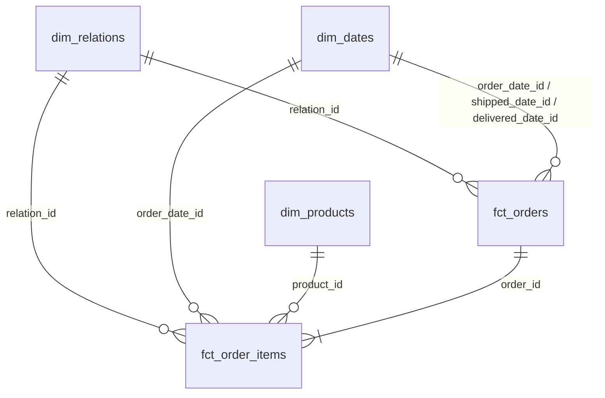

# Data Model

## Schema Layers and Materializations

PostgreSQL data is organized into four isolated schemas that separate raw source ingestion, standardized views, analytical star-schema tables, and pre-aggregated reporting output tables. In dbt (`etl/dbt_project.yml`), model materialization can be configured using any of the following options:
1. **Model-level SQL config** — override a single model with `{{ config(materialized='incremental') }}` (for example, on large fact tables).
2. **Folder-level project config** — set `+schema` and `+materialized` per layer in `etl/dbt_project.yml`.
3. **Default layer settings** — use the preconfigured `staging` (`view`), `marts` (`table`), and `reporting` (`table`) layers as-is.

Default schema and materialization settings:
- **`raw` schema** (`db/*.sql`): Physical PostgreSQL **tables** (`raw.relations`, `raw.orders`, `raw.order_items`) storing unmodified source data.
- **`staging` schema** (`etl/models/staging/`): PostgreSQL **views** (`+materialized: view`) providing a lightweight 1-to-1 standardization layer without duplicating storage on disk.
- **`marts` schema** (`etl/models/marts/`): Physical PostgreSQL **tables** (`+materialized: table`) storing pre-computed dimension (`dim_*`) and fact (`fct_*`) tables for fast analytical queries.
- **`reporting` schema** (`etl/models/reporting/`): Physical PostgreSQL **tables** (`+materialized: table`) storing pre-aggregated output tables (`rpt_*`) built on top of `marts`.

*(Note: `etl/macros/generate_schema_name.sql` resolves custom dbt schemas directly to `staging`, `marts`, and `reporting` rather than prefixing them with `POSTGRES_SCHEMA`.)*

1. Override materialization for a single large fact model (e.g., incremental table):
```sql
{{ config(materialized='incremental', unique_key='id') }}

SELECT ...
```

2. Configure schema and materialization at the folder level in `etl/dbt_project.yml`:
```yaml
models:
  etl:
    staging:
      +schema: staging
      +materialized: view
    marts:
      +schema: marts
      +materialized: table
    reporting:
      +schema: reporting
      +materialized: table
```

3. Build all layers with default settings:
```bash
.venv/bin/dbt run --project-dir etl --profiles-dir etl
```

## Dimensions (`dim_*`) vs. Facts (`fct_*`)

Both `dim_*` and `fct_*` models in `marts` are physical PostgreSQL tables; the prefixes define their role in a **star schema** for analytical queries. You can query the star schema using any of the following patterns:
1. **Role-playing dimension joins** — join `dim_dates` multiple times using `order_date_id`, `shipped_date_id`, or `delivered_date_id`.
2. **Order-header analysis (`fct_orders`)** — aggregate order-level metrics such as `shipping_amount` and `total_amount` without fan-out from line items.
3. **Line-item star-schema query (`fct_order_items`)** — join `fct_order_items` to `dim_dates`, `dim_relations`, and `dim_products` to group metrics by descriptive attributes.

Role definitions and key conventions:
- **Dimensions (`dim_*`) — Context ("Who, What, Where, When"):** Descriptive reference tables containing text attributes, categories, and flags used in `WHERE` filters and `GROUP BY` clauses. Relatively small and slow-changing.
- **Facts (`fct_*`) — Events & Measures ("How Much, How Many"):** Event/transaction tables at a specific grain containing foreign keys (`*_id`) to dimensions plus numeric measures aggregated with `SUM()`, `COUNT()`, and `AVG()`.
- **Primary keys (`id`):** Every model in `staging` and `marts` exposes its own primary key as `id` (renaming source IDs such as `order_id AS id`, and generating deterministic integer IDs on derived dimensions such as `ROW_NUMBER()` on `dim_products` and `YYYYMMDD` integers on `dim_dates`). `raw` tables keep their original column names.
- **Foreign keys (`<entity>_id` / `<role>_<entity>_id`):** Foreign keys reference target `id` columns by entity name (`relation_id`, `order_id`, `product_id`) or role-qualified name (`order_date_id`, `shipped_date_id`, `delivered_date_id`).



| Schema & Object | Type | Grain | PK | Foreign Keys | Key Attributes / Measures |
| :--- | :--- | :--- | :--- | :--- | :--- |
| `raw.relations` | Table | 1 row per relation | `relation_id` | — | Raw customer, partner, supplier, and prospect records |
| `raw.orders` | Table | 1 row per order | `order_id` | `relation_id` | Raw order headers, currency, amounts, and lifecycle timestamps |
| `raw.order_items` | Table | 1 row per order line | `order_item_id` | `order_id` | Raw SKU line items, quantities, discounts, taxes, and totals |
| `staging.stg_relations` | View | 1 row per relation | `id` | — | Standardized view over `raw.relations` |
| `staging.stg_orders` | View | 1 row per order | `id` | `relation_id` | Standardized view over `raw.orders` |
| `staging.stg_order_items` | View | 1 row per order line | `id` | `order_id` | Standardized view over `raw.order_items` |
| `marts.dim_relations` | Table | 1 row per relation | `id` | — | `external_ref`, `relation_type`, `relation_role`, `city`, `country_code`, `status` |
| `marts.dim_products` | Table | 1 row per SKU | `id` | — | `sku`, `product_name`, `product_category`, `unit_price` |
| `marts.dim_dates` | Table | 1 row per calendar day | `id` (`YYYYMMDD`) | — | `date_day`, `year`, `quarter`, `month_name`, `iso_week`, `day_name`, `is_weekend` |
| `marts.fct_orders` | Table | 1 row per order | `id` | `relation_id`, `order_date_id`, `shipped_date_id`, `delivered_date_id` | `line_count`, `total_quantity`, `subtotal_amount`, `discount_amount`, `tax_amount`, `shipping_amount`, `total_amount` |
| `marts.fct_order_items` | Table | 1 row per order line | `id` | `order_id`, `relation_id`, `product_id`, `order_date_id` | `quantity`, `unit_price`, `line_subtotal`, `line_discount`, `line_tax`, `line_total` |
| `reporting.rpt_weekly_orders` | Table | 1 row per week + currency + status | `id` | — | `year`, `week`, `currency_code`, `order_status`, `order_count`, `order_line_count`, `total_order_amount` |

1. Join role-playing dates (`ordered` vs. `delivered`) on `fct_orders`:
```sql
SELECT
    o.order_number,
    od.date_day AS ordered_on,
    dd.date_day AS delivered_on,
    (dd.date_day - od.date_day) AS delivery_days
FROM marts.fct_orders AS o
JOIN marts.dim_dates AS od ON od.id = o.order_date_id
JOIN marts.dim_dates AS dd ON dd.id = o.delivered_date_id;
```

2. Aggregate order-level totals (`fct_orders` + `dim_relations`):
```sql
SELECT
    r.country_code,
    o.currency_code,
    COUNT(*)            AS order_count,
    SUM(o.total_amount) AS gross_revenue
FROM marts.fct_orders AS o
JOIN marts.dim_relations AS r ON r.id = o.relation_id
WHERE o.order_status = 'delivered'
GROUP BY r.country_code, o.currency_code;
```

3. Standard star-schema query across dimensions and line-item facts:
```sql
SELECT
    d.year,
    r.country_code,
    p.product_category,
    SUM(f.quantity)   AS units_sold,
    SUM(f.line_total) AS revenue
FROM marts.fct_order_items AS f
JOIN marts.dim_dates     AS d ON d.id = f.order_date_id
JOIN marts.dim_relations AS r ON r.id = f.relation_id
JOIN marts.dim_products  AS p ON p.id = f.product_id
GROUP BY d.year, r.country_code, p.product_category;
```
